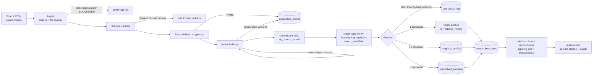

# id-mapper: deterministic ID mapping pipeline

**Author:** Saksham Mehrotra (mehrotrasaksham0507@gmail.com)

Maps customer identifiers from three source systems (`crm`, `billing`, `support`) to **canonical IDs**
in a customer master, using **exact and rule-based matching**. The pipeline:

- detects **one-to-many conflicts**, and surfaces them instead of auto-resolving them;
- keeps **full mapping history** (SCD Type 2, event-time intervals, late-arrival protection);
- exposes **unresolved mappings** as a work queue with a reason per key;
- runs locally with one command, is **idempotent** (checksum skip plus deterministic merge), **observable**
  (run table plus JSON stage logs), **tested** (169 tests, 96% coverage) and **reconciled** (12 hard checks).

Stack: Python 3.11+, DuckDB (embedded, file-based), pytest, click, YAML. No services or credentials. Synthetic data only.

| On the 100k generated dataset | |
|---|---|
| Spec conformance vs ground-truth labels | **100%** (97,243 / 97,243 keys) |
| Precision / recall vs true entity | 99.65% / 91.44% (both below 100% by design, see [Quality](#data-quality-reconciliation-and-quality-metrics)) |
| Designed reject rows caught at the right file, line and code | 4,490 / 4,490 |
| Hard reconciliation checks, including rebuild determinism | 12 / 12 PASS |
| End-to-end runtime | ~3 s for 103k rows; ~25 s for 1M rows (see [Performance](#performance)) |

---

## Quickstart

```bash
make setup      # creates .venv and installs pinned dependencies (Python 3.11+)
make generate   # seeded synthetic data (N=100000, SEED=42) -> data/generated, staged into data/incoming
make run        # processes every batch in data/incoming, in filename order
make test       # 169 tests -> output/test_results.txt, output/coverage.txt
make report     # reconciliation + quality report -> output/report.md (exit code 1 if a hard check fails)
```

Other targets: `make status` (recent runs), `make sample` (rebuild `output/sample_run/` from the committed
sample), `make perf` (10k / 100k / 1M timings into `output/perf.md`, about 3 minutes), `make clean`.

`make run` reports one **FAILED** file, `broken_schema_batch.csv`. That is intended: the file has no
`source_updated_at` column, so the pipeline must reject it as a whole and record why. The other files
succeed, and the failed file is retried on every later run until it is fixed. A second `make run`
shows the checksum skip: every succeeded file becomes **SKIPPED**.

Without make: `pip install -r requirements.txt`, then `PYTHONPATH=src python -m idmap --help`
(or `pip install -e .` to get an `idmap` command).

### What is committed as evidence

| Path | Content |
|---|---|
| `data/sample/` | Small curated input set (about 50 rows per source plus late, drift and broken batches). Every scenario appears at least once |
| `data/expected/` | Ground-truth labels for the sample, kept apart from the inputs |
| `output/sample_run/` | Sample run: `report.md`, every table exported as CSV (`tables/`), `run_log.jsonl`, `status.txt` |
| `output/report.md` | Report for the 100k generated dataset |
| `output/test_results.txt`, `output/coverage.txt` | `pytest -v` output and coverage summary |
| `output/perf.md` | Performance at 10k / 100k / 1M rows |

---

## Architecture



Everything from the schema check through metrics runs in **one DuckDB transaction per file**. The
`pipeline_run` row is written before the transaction, so a failure is always recorded. It is set to
SUCCEEDED inside the transaction, so SUCCEEDED means the data committed. Any exception rolls back,
the run becomes FAILED with `<stage>: <Exception>: <message>`, and the next run retries the file
from scratch.

### Repository layout

```
├── README.md  DESIGN.md  DATA_DICTIONARY.md  Makefile  requirements.txt  pyproject.toml
├── config/pipeline.yaml        paths, rule priorities, normalization, thresholds, generator rates
├── src/idmap/
│   ├── cli.py                  click entry point (run | status | report | export)
│   ├── config.py               YAML -> validated, frozen Config
│   ├── db.py                   connection, DDL, transaction helper
│   ├── pipeline.py             orchestration: one transaction per file, failure handling, failure injection
│   ├── ingest.py               discovery, checksums, registry, CSV parsing with line numbers, reference load
│   ├── validate.py             schema contract, row rules -> quarantine, in-batch dedup
│   ├── normalize.py            normalization rules as DuckDB macros + identical Python functions
│   ├── match.py                rule engine -> candidates (blocking-key equi-joins)
│   ├── resolve.py              decisions; conflict / unresolved / status tables
│   ├── publish.py              late-arrival detection, SCD2 merge
│   ├── metrics.py              run ids, JSON logs, stage timing
│   ├── report.py               hard checks, determinism replay, quality metrics, Markdown report, export
│   └── baseline.py             row-by-row Python matcher (performance baseline and parity oracle)
├── scripts/generate.py         seeded synthetic data + labels (independent of the pipeline code)
├── scripts/perf.py             10k / 100k / 1M benchmark
├── data/{sample,expected}/     committed sample and its labels; data/{generated,incoming}/ are gitignored
├── output/                     committed evidence (see above)
└── tests/                      169 tests (test_pipeline.py = the plan's 22 scenarios in order)
```

---

## How it works

### Input contract

One CSV per batch, in `data/incoming/`, processed in filename order. Required columns are
`source_system`, `source_id` and `source_updated_at` (ISO-8601, UTC if no offset). Optional columns are
`name`, `email`, `phone`, `domain`, `tax_id` and `canonical_ref`. Columns are matched by header name.
Extra columns produce a schema warning and are dropped; missing optional columns produce a warning and
read as NULL. Details are in [DATA_DICTIONARY.md](DATA_DICTIONARY.md#1-input-source-batch-csv-contract).
The canonical master (`canonical_entity.csv`) and the steward crosswalk (`mapping_override.csv`) are
reference inputs, reloaded only when their checksum changes.

### Validation and quarantine

Each rejected row gets one reason code: the first rule it fails, checked in this order:
`MALFORMED_ROW` > `MISSING_REQUIRED_FIELD` > `UNKNOWN_SOURCE_SYSTEM` > `TYPE_CAST_FAILED` > `INVALID_EMAIL` >
`INVALID_PHONE` > `INVALID_CANONICAL_REF`. Then, within the batch, **exact duplicates** (identical after
trimming) are dropped and counted, and older versions of a key are quarantined as `DUPLICATE_KEY_SUPERSEDED`
(newest `source_updated_at` wins; on a tie, the later line). Each quarantined row keeps `run_id`,
`source_file`, the **physical line number** (multi-line quoted fields handled) and the original untrimmed
values as JSON. A file in which more than 50% of rows fail validation is treated as broken and fails
(circuit breaker, configurable).

### Normalization (SQL, set-based)

| Field | Rule |
|---|---|
| all | Unicode-aware trim; empty or whitespace-only -> NULL |
| `email` | lowercase |
| `phone` | digits only, E.164 style: `+` kept, `00` -> `+`, 10 digits -> `+<default_country_code>` |
| `name` | NFC, lowercase, non-alphanumerics -> space, collapse, drop trailing `inc/ltd/pvt/llc/corp` (and long forms) |
| `domain` | lowercase, strip scheme, `www.`, path/query, port, edge dots |
| `tax_id` | uppercase, strip whitespace and hyphens |

These are DuckDB macros (`normalize.py`). The same rules also exist in Python, and a 33-input parity test
(accents, NFD, Greek, Cyrillic, CJK, Devanagari, Turkish İ, em-spaces, ...) asserts the two give identical results.

### Matching and resolution

| Priority | Rule | Key |
|---|---|---|
| P0 | `manual_override` | (system, id) in `mapping_override` |
| P1 | `exact_tax_id` | `tax_id_norm` |
| P2 | `exact_email` | `email_norm` = canonical `primary_email` |
| P3 | `rule_name_domain` | `name_norm` + `domain_norm` |
| P4 | `rule_phone_name` | `phone_norm` + first token of `name_norm` |

Each rule is an equi-join between the batch's `(rule_id, key_value)` pairs and the master's
`canonical_key` index, with no cross joins. For each key, the **highest-priority rule with any active
hit decides**: one canonical is **MAPPED**; more than one is a **CONFLICT** (`ONE_TO_MANY`, never
auto-picked); none is **UNRESOLVED** with reason `INACTIVE_CANONICAL_ONLY`, `INSUFFICIENT_ATTRIBUTES`
(tax_id, email and name all null) or `NO_CANDIDATE`. Every active hit is kept in `match_candidate`
with the key that matched, so every decision can be explained. Two ids from the same system mapping to one
canonical raise a `MANY_TO_ONE_SAME_SYSTEM` warning, and both mappings stay.

### History (SCD2) and late arrivals

| Situation | Action |
|---|---|
| No current mapping | insert current row (`valid_from` = event time) |
| Same canonical as current | no-op |
| Different canonical, record not late | close current (`valid_to` = new `valid_from`, `closed_run_id`), insert new |
| Record older than the newest evidence already applied to the key | **late arrival**: nothing changes, logged in `late_arrival_log` with the outcome it would have produced |
| Conflict or unresolved, but the key is already mapped | **keep the mapping**; conflict or unresolved row flagged `has_existing_mapping` |

`mapping_id = sha256(system|id|canonical|valid_from)`, so rebuilding from the same inputs reproduces
the same history byte for byte.

### Idempotency, retry, restart, backfill

- **Rerun:** the file's SHA-256 already SUCCEEDED, so the run is recorded as SKIPPED and nothing else
  changes. The same content under another name is also skipped.
- **`--force`:** reprocesses with no duplicates. Mapping ids are deterministic, state tables are upserted,
  batch rows are replaced per checksum, and `attempt_count` does not count the same file twice.
  Fingerprints are asserted identical.
- **Partial failure:** rollback, so no partial writes. The run is marked FAILED with the stage and error,
  and the next `make run` retries it. Tested by injecting a failure at each of the 10 stages
  (`IDMAP_FAIL_AT_STAGE=<stage>`).
- **Restart:** `make run` processes every file not yet SUCCEEDED. A RUNNING row left by a killed
  process is marked FAILED (abandoned) at the next start.
- **Backfill:** drop historical files into `data/incoming/` and run. New keys load; stale evidence
  for existing keys is logged but does not override current state.

### Observability

- `pipeline_run`: status, timing and every count per file attempt (`make status`).
- `output/logs/<run_id>.jsonl`: one JSON line per stage, with `run_id`, `stage`, `rows_in`, `rows_out`,
  `duration_ms`, `level` and stage counts. Failures include `failed_stage` and `failure_reason`.
- Readable progress on stderr (`-q` shows warnings and errors only).

---

## Data quality: reconciliation and quality metrics

`make report` writes `output/report.md` and **exits 1 if any hard check fails**:

| # | Hard check |
|---|---|
| 1 | `rows_read = rows_staged + rows_quarantined + duplicates_dropped` for every run |
| 1b | `rows_staged = mapped + conflicts + unresolved + late_arrivals` for every run |
| 1c | run counters match the rows actually stored |
| 2 | distinct staged keys = MAPPED + CONFLICT + UNRESOLVED in `source_key_status` |
| 3 | at most one `is_current` row per key |
| 4 | every current `canonical_id` exists and is active |
| 5 | no overlapping `[valid_from, valid_to)` intervals; closed and current rows well-formed |
| 6 | every quarantined row has `run_id`, `source_file`, `source_row_num` and a known reason code |
| 7 | **determinism:** every succeeded run is replayed into a scratch DB and 8 tables are compared by fingerprint |
| 8 | `source_key_status` agrees with `id_mapping_current` |
| 9 | open conflicts and unresolved rows agree with per-key status |
| 10 | logical keys of the append-only tables are unique |

Checks 1 and 1b also run **inside** every run, before commit. Tests corrupt the database one way at a
time to prove that each check catches its violation.

**Quality metrics** compare results with labels the generator writes separately from the inputs.
There are two views:

- **Spec conformance:** final status and canonical vs what a correct implementation of the rules
  must produce. Result: 100% on the sample, on the 100k dataset, and in tests on other seeds.
- **Identity quality:** mappings vs the record's *true* entity. Precision 99.65%, recall 91.44%.
  Both are intentionally imperfect. Designed one-to-many conflicts and dirty (typo'd) names cost recall,
  because the pipeline is conservative by design. Designed phone+name collisions cost precision of
  `rule_phone_name` (94.2%, against 100% for the exact rules), which is why P4 has the lowest priority.

The report also shows precision and recall per rule, match, conflict, unresolved and quarantine rates,
the quarantine breakdown with row-level matching against expected rejects, the expected-vs-actual
confusion matrix, agreement per scenario, designed vs observed volumes, how often the legacy
`canonical_ref` agrees with the mapping, and soft thresholds from config (WARN, never FAIL).

### Synthetic data

`python scripts/generate.py --n 100000 --seed 42 --out data/generated` is fully deterministic: same
seed, same bytes, and a test checks it. Rates are configured in `config/pipeline.yaml`. Injected scenarios:
exact duplicates (2%), same key with a conflicting payload (1%), missing required fields (1%), malformed
email, phone or timestamp (1.5%), unknown source system (0.5%), invalid `canonical_ref` (0.5%), designed
one-to-many conflicts through shared mailboxes and same-name/same-domain legal entities (1%), entities
absent from the master (5%), inactive-only matches (0.5%), boundary values (1%: Unicode and NFD names,
255-character names, whitespace-only fields, embedded newlines, 64-character ids), malformed lines, dirty
names, weak-rule false positives, duplicate accounts and steward overrides. `crm_batch_002.csv` carries
late re-sends (older timestamps), remaps, a conflict on a mapped key, and unresolved keys that later
map. `schema_drift_batch.csv` has an extra column, reordered columns and an absent optional column.
`broken_schema_batch.csv` lacks a required column. The generator does not import the pipeline:
attribute noise is built to vanish under the documented normalization, and labels follow from the
designed key values.

---

## Testing

`make test` runs 169 tests in about 20 s: 96% line coverage, with output committed to
`output/test_results.txt`. Tests build small fixtures by hand with explicit expected outputs.

- `tests/test_pipeline.py`: the plan's 22 scenarios, numbered in plan order. These cover the happy path,
  empty file, malformed rows (with exact line numbers, multi-line fields and invalid UTF-8), missing
  required fields, optional nulls, insufficient attributes, exact and conflicting duplicates, schema drift
  and missing columns, invalid `canonical_ref`, rerun skip, forced rerun, failure plus retry at **every
  stage**, one-to-many conflicts, rule precedence, remaps, late arrivals (including the
  newer-than-`valid_from`-but-stale case), normalization collisions, inactive canonicals, conflicts that
  keep an existing mapping, and many-to-one warnings.
- `test_normalize.py`: normalization rules plus SQL/Python parity; timestamp parsing and time zones.
- `test_validation.py`: reason precedence, time zones, circuit breaker, BOM, blank lines, duplicate headers.
- `test_operations.py`: overrides, reference reload, unresolved lifecycle, abandoned runs, restart order,
  backfill, rule configuration.
- `test_report.py`: all checks pass on valid state, and each one fails on a targeted corruption;
  determinism replay; quality metrics.
- `test_baseline.py`: Python baseline and SQL engine make identical decisions under three rule configs.
- `test_generator.py`: seeded reproducibility; the committed sample regenerates byte-identically; full
  pipeline vs labels at 100% on the sample and on two other seeds.
- `test_cli.py`: commands and exit codes.

---

## Performance

`make perf` writes [output/perf.md](output/perf.md) (12-core Apple Silicon laptop):

| Target rows | Rows read | Pipeline wall time | Rows/s | Peak RSS | Matching: Python baseline | Matching: DuckDB set-based | Speedup | Identical decisions |
|---|---|---|---|---|---|---|---|---|
| 10k | 10,317 | 0.6 s | 16,942 | 223 MB | 0.07 s | 0.07 s | 1.0x | yes |
| 100k | 103,157 | 3.2 s | 31,753 | 547 MB | 0.67 s | 0.53 s | 1.3x | yes |
| 1M | 1,031,721 | 25.2 s | 40,905 | 2,044 MB | 7.30 s | 1.90 s | 3.9x | yes |

At 10k rows, fixed overhead dominates and the two engines are level. The set-based path pulls ahead
as volume grows: Python is linear and single-threaded, while DuckDB vectorizes across cores.

Optimization shown: a **row-by-row Python baseline** (Python normalization plus dict lookups per record)
against the **set-based** path (SQL normalization macros plus equi-joins on blocking keys). Both engines
are checked to make byte-identical decisions. Next steps, documented but not built: incremental
processing of changed keys only (attribute hash), a native CSV reader in place of the Python line-number
pass (now the largest stage), partitioning by `source_system`, and a Spark/Databricks port for multi-node
scale (DESIGN.md §12).

---

## Sample queries

The database is a single DuckDB file. Use the DuckDB CLI (`duckdb data/idmap.duckdb`) or Python:

```bash
.venv/bin/python -c "import duckdb; print(duckdb.connect('data/idmap.duckdb', read_only=True).sql('''
  SELECT * FROM id_mapping_current LIMIT 5'''))"
```

```sql
-- Current mapping for a key
SELECT canonical_id, match_rule, valid_from
FROM id_mapping_current WHERE source_system = 'crm' AND source_id = 'CRM-0000022';

-- Full history of a key (in the committed sample this key was remapped on 2026-10-02)
SELECT canonical_id, match_rule, valid_from, valid_to, is_current, created_run_id, closed_run_id
FROM id_mapping_history WHERE source_system = 'crm' AND source_id = 'CRM-0000022' ORDER BY valid_from;

-- Why was it mapped? Every rule hit, strongest first
SELECT run_id, rule_id, rule_priority, canonical_id, matched_value
FROM match_candidate WHERE source_system = 'crm' AND source_id = 'CRM-0000022' ORDER BY run_id, rule_priority;

-- Open conflicts, the steward's queue (resolve by adding rows to mapping_override.csv)
SELECT conflict_type, source_system, source_id, candidate_canonical_ids, rule_id, existing_canonical_id
FROM mapping_conflict WHERE status = 'OPEN' ORDER BY conflict_type, source_system, source_id;

-- Unresolved backlog by reason
SELECT reason, count(*) AS keys, count(*) FILTER (WHERE has_existing_mapping) AS keep_old_mapping
FROM unresolved_mapping WHERE status = 'OPEN' GROUP BY reason ORDER BY keys DESC;

-- Run history
SELECT run_seq, source_file, status, rows_read, rows_staged, rows_quarantined, mapped, conflicts,
       unresolved, late_arrivals, duration_ms, failure_reason
FROM pipeline_run ORDER BY run_seq;

-- Quarantine for one file, with the original values
SELECT source_row_num, reject_reason_code, reject_detail, raw_payload
FROM quarantine_record WHERE source_file LIKE '%crm_batch_001.csv' ORDER BY source_row_num;

-- Late arrivals that would have changed the mapping
SELECT source_system, source_id, record_updated_at, latest_applied_updated_at, current_canonical_id, proposed_canonical_id
FROM late_arrival_log WHERE proposed_canonical_id IS DISTINCT FROM current_canonical_id;
```

---

## Configuration

`config/pipeline.yaml` (or `--config`, or `IDMAP_CONFIG`) sets paths, allowed source systems, the
reject-rate circuit breaker, the default phone country code, legal suffixes, **rule priorities and
on/off switches** (rules sharing a priority pool their hits), soft quality thresholds, DuckDB
threads and memory, and generator rates. The CLI overrides the main paths:

```
idmap [--config F] [--db F] [--log-dir D] [-q] run [--incoming D] [--pattern GLOB] [--file F]...
                                                   [--canonical F] [--overrides F] [--force] [--allow-failures]
idmap status [--limit N]
idmap report [--expected-dir D] [--out F] [--skip-determinism]
idmap export --out D
```

`run` exits 1 when any file FAILED, unless `--allow-failures` is given. The Makefile passes that flag so
the demo chain continues past the designed broken file.

---

## Assumptions

1. `canonical_entity` is a provided reference master. This pipeline maps to it and does not build it.
2. The business key is `(source_system, source_id)`. `source_system` is compared case-insensitively.
3. `source_updated_at` is event time and drives ordering, history and late-arrival detection. Values
   without an offset are UTC.
4. Matching is deterministic rules only: exact equality on normalized keys, no fuzzy or ML matching.
5. Conflicts are surfaced, never auto-resolved. Stewards resolve them through `mapping_override` (P0).
6. New evidence changes a mapping only when it resolves to exactly one active canonical, and never when
   it is older than evidence already applied.
7. Input arrives as one CSV per batch in `data/incoming/`, processed in filename order.
8. `canonical_ref` is a legacy claim: validated and measured, not trusted for matching.
9. A file is the unit of atomicity: it commits completely or not at all.

## Known limitations

- Deterministic rules only, so recall is capped on dirty names (the report quantifies the loss).
- Single-node DuckDB, not distributed (about 25 s and 2.0 GB peak for 1M rows on a laptop).
- Late arrivals are logged but do not rewrite past intervals. History is not bitemporal.
- Conflict resolution is manual, via `mapping_override.csv`. There is no UI or approval workflow.
- No survivorship or golden-record creation: the master is an input.
- Equal-timestamp versions of a key from different files are applied in filename order.
- The CSV pre-pass (exact line numbers) is single-threaded Python and is the largest stage at 1M rows.

## Next steps

- Incremental processing: skip records whose attribute hash and timestamp are unchanged.
- Native CSV parsing with a rejects table; recompute MANY_TO_ONE only for touched canonicals.
- A steward review UI on `mapping_conflict` that writes overrides with an approval trail.
- An optional fuzzy or phonetic candidate rule at the lowest priority, routed to review rather than auto-mapped.
- Bitemporal history (`recorded_from/to`), so backfills can correct past intervals.
- Spark/Databricks port: blocking-key shuffle joins, Delta `MERGE` for SCD2, partitioning by `source_system`.

See [DESIGN.md](DESIGN.md) for the reasoning behind each decision and [DATA_DICTIONARY.md](DATA_DICTIONARY.md)
for every table and column.
